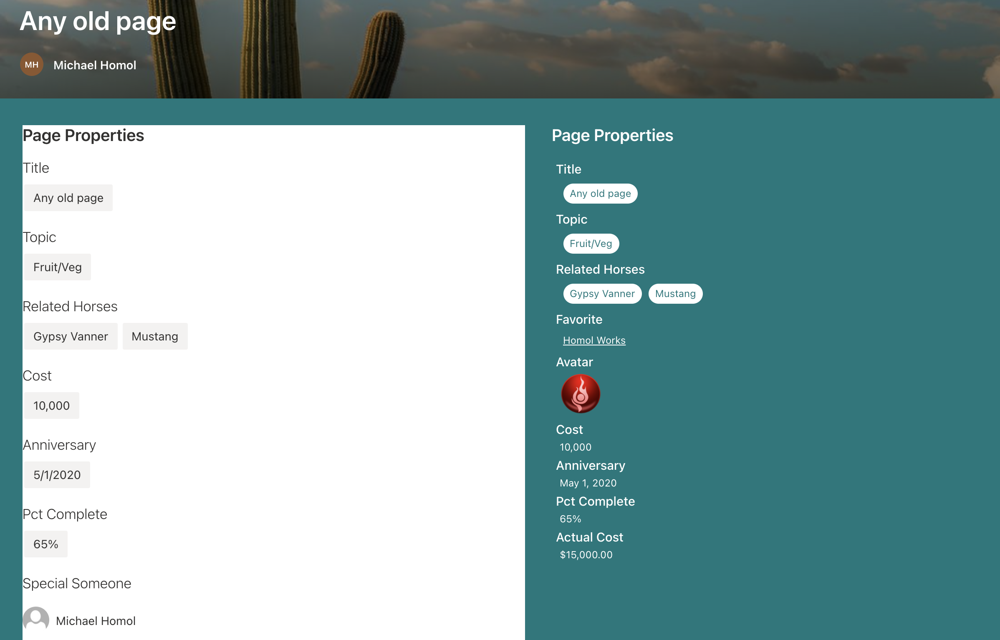

# Advanced Page Properties

## Summary

Attempts to replicate the functionality of Page Properties with the following improvements:

- Support for theme variants
- Updated to standard capsule look for list options
- Support for image fields
- Support for hyperlink fields
- Support for currency
- Improved support for dates



## [Used SharePoint Framework Version](https://learn.microsoft.com/en-us/sharepoint/dev/spfx/compatibility)


## Applies to

- [SharePoint Framework](https://aka.ms/spfx)
- [Microsoft 365 tenant](https://docs.microsoft.com/en-us/sharepoint/dev/spfx/set-up-your-developer-tenant)

> Get your own free development tenant by subscribing to [Microsoft 365 developer program](http://aka.ms/o365devprogram)

## Prerequisites

- Node.js v10.x or later
- SharePoint Framework development environment (SPFx 1.11.0)
- Access to a SharePoint Online tenant or Microsoft 365 developer tenant
- App Catalog configured in your tenant (for deployment)

## Solution

Solution|Author(s)
--------|---------
/ | Mike Homol, Principal Consultant, ThreeWill

## Version history

Version|Date|Comments
-------|----|--------
1.0|March 30, 2021|Initial release
1.0.2|Aug 29, 2024|Capsule search links (configurable)
1.0.2.4|Sep 14, 2024|Configurable query string field for capsule link
1.0.3|Sep 20, 2024|Added support for single-select taxonomy fields

## Disclaimer

**THIS CODE IS PROVIDED *AS IS* WITHOUT WARRANTY OF ANY KIND, EITHER EXPRESS OR IMPLIED, INCLUDING ANY IMPLIED WARRANTIES OF FITNESS FOR A PARTICULAR PURPOSE, MERCHANTABILITY, OR NON-INFRINGEMENT.**

---

## Minimal Path to Awesome

### Development Setup

- Clone this repository
- Ensure that you are at the solution folder
- In the command-line run:
  - **npm install**
  - **gulp serve**

### Deployment

1. Build the solution:
   ```
   gulp build --ship
   ```

2. Bundle the solution:
   ```
   gulp bundle --ship
   ```

3. Package the solution:
   ```
   gulp package-solution --ship
   ```

4. Deploy the `.sppkg` file from `sharepoint/solution/` to your tenant's App Catalog

5. Add the app to your site collection and then add the web part to a page

## Features

### Core Functionality

This web part replicates the standard SharePoint Page Properties web part with enhanced capabilities:

- **Theme Variant Support**: Automatically adapts to your SharePoint site's theme colors for a seamless visual experience
- **Modern Capsule UI**: Displays list values in a modern capsule/pill format with clickable links
- **Enhanced Field Type Support**: Better handling of various SharePoint field types
- **Configurable Search Links**: Capsule values can link to search pages with customizable query string parameters

### Supported Field Types

The web part supports the following field types with special formatting:

- **Taxonomy Fields** (Single-select and Multi-select) - Displays as clickable capsules with term labels
- **Hyperlink/URL Fields** - Renders as clickable links with description text
- **Thumbnail/Image Fields** - Displays images inline
- **Currency Fields** - Formatted with currency symbols and optional comma separators
- **Number Fields** - Supports percentage display and comma separators
- **Date/Time Fields** - Multiple format options:
  - Standard US format
  - ISO8601 format
  - Day of week format
  - Month spelled out format
- **Multi-Choice Fields** - Displays all selected values as capsules
- **Text and Choice Fields** - Standard text display as capsules

**Note**: The following field types are excluded from selection: Boolean, Note (multi-line text), and User fields.

### Configuration Options

When configuring the web part, you can set:

1. **Title** - Optional title displayed at the top of the web part
2. **Capsule Link URL** - Base URL for capsule links (defaults to `/_layouts/15/search.aspx/siteall`)
3. **Query String Configuration**:
   - Option to use the field's internal name as the query string parameter name
   - Or specify a custom query string parameter name (defaults to "q")
4. **Property Selection** - Dynamically add or remove page properties to display

### Usage

> Add the part

Once the solution is installed in the app catalog and the app has been added to the site, you should see it available to a page.


> Familiarity is key

This web part tries to mimic the original Page Properties web part as much as possible. You should recognize the functionality of the property setup.  

Basically add and remove properties until you are satisfied and you're good to go!


### Special Features

- **Taxonomy Field Handling**: Single-select taxonomy fields have special handling to correctly retrieve and display term labels (addresses a known SharePoint API limitation)
- **Theme Integration**: The web part automatically uses semantic colors from your site's theme for backgrounds, text, links, and capsule styling
- **Responsive Design**: Capsules wrap appropriately and the layout adapts to different screen sizes

