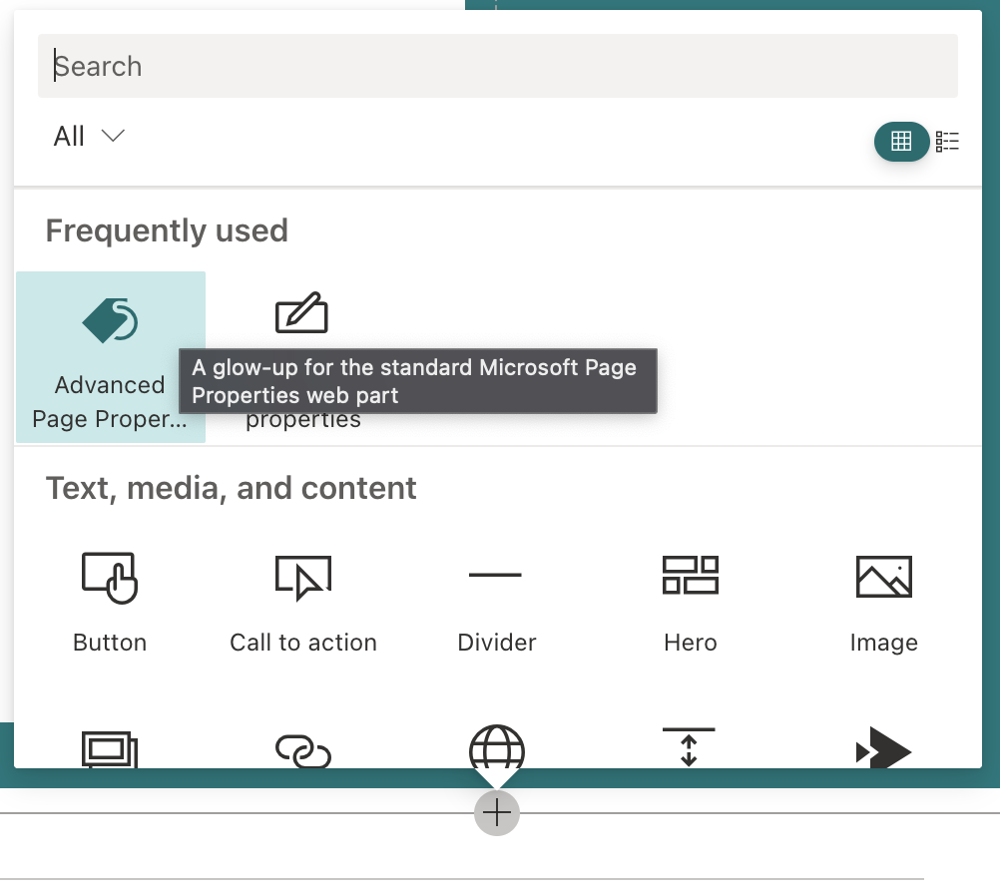
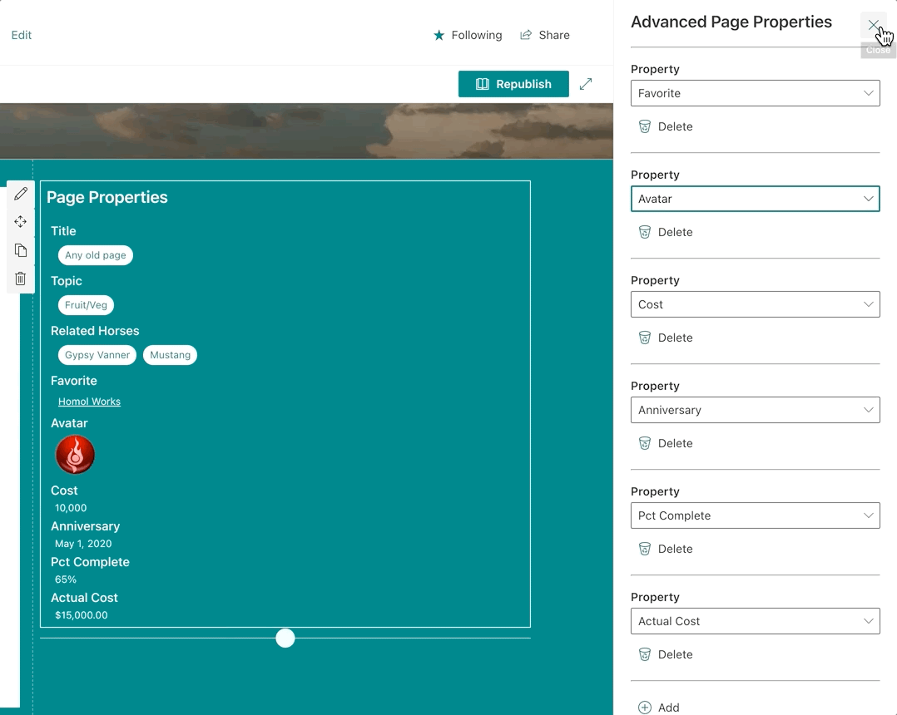

# Advanced Page Properties

MIT-licensed [SharePoint Framework](https://learn.microsoft.com/sharepoint/dev/spfx/sharepoint-framework-overview) solution by [ThreeWill](https://threewill.com). Display modern page metadata with enhanced field formatting, capsule search links, and a dedicated URL tile/embed web part.

[](https://github.com/threewill/advanced-page-properties/actions/workflows/ci.yml)


## Summary

This solution contains two web parts for displaying page properties with enhanced capabilities:

### Advanced Page Properties
Attempts to replicate the functionality of Page Properties with the following improvements:

- Support for theme variants
- Updated to standard capsule look for list options
- Support for image fields
- Support for hyperlink fields
- Support for currency
- Improved support for dates
- Support for Boolean fields with multiple display formats
- Flexible display modes (capsule or text) with customizable text styles
- Option to hide property labels

### URL Page Properties
A specialized web part for displaying URL page properties as interactive tiles or embedded views:

- Tile-based display similar to Quick Links
- Embedded iframe display for inline views (e.g. document library folders)
- Per-property display mode: tile link or embedded iframe
- Configurable embed height and optional minimal chrome (no border, title, or link)
- Configurable tile sizes (Extra Small to Extra Large)
- Icon picker integration for custom tile icons
- Smart display name resolution (configured name → URL description → filename)
- Theme variant support


## Used SharePoint Framework Version

[SharePoint Framework 1.23](https://learn.microsoft.com/en-us/sharepoint/dev/spfx/compatibility)

## Applies to

- [SharePoint Framework](https://aka.ms/spfx)
- [Microsoft 365 tenant](https://docs.microsoft.com/en-us/sharepoint/dev/spfx/set-up-your-developer-tenant)

> Get your own free development tenant by subscribing to [Microsoft 365 developer program](http://aka.ms/o365devprogram)

## Prerequisites

- Node.js **22.14+** (see `.nvmrc`; also supports Node 18.17.x)
- SharePoint Framework **1.23.x** with Heft toolchain
- Access to a SharePoint Online tenant or Microsoft 365 developer tenant
- App Catalog configured in your tenant (for deployment)

## Solution

Solution|Author(s)
--------|---------
Advanced Page Properties | [ThreeWill](https://threewill.com) (Mike Homol)

## Version history

Version|Date|Comments
-------|----|--------
1.0|March 30, 2021|Initial release
1.0.2|Aug 29, 2024|Capsule search links (configurable)
1.0.2.4|Sep 14, 2024|Configurable query string field for capsule link
1.0.3|Sep 20, 2024|Added support for single-select taxonomy fields
1.0.5||Added URL Page Properties web part with tile display support; Added Boolean field support with multiple display formats
1.0.5.3|May 24, 2026|URL Page Properties: embedded iframe display mode with configurable height and minimal chrome
1.1.0.0|July 2026|SPFx 1.23 / Heft migration; PnPjs v4; Node 22; page list resolved via page context

## Disclaimer

This project is licensed under the [MIT License](LICENSE). See [SECURITY.md](SECURITY.md) for vulnerability reporting and [CONTRIBUTING.md](CONTRIBUTING.md) for development guidelines.

**THIS CODE IS PROVIDED *AS IS* WITHOUT WARRANTY OF ANY KIND, EITHER EXPRESS OR IMPLIED, INCLUDING ANY IMPLIED WARRANTIES OF FITNESS FOR A PARTICULAR PURPOSE, MERCHANTABILITY, OR NON-INFRINGEMENT.**

---

## Minimal Path to Awesome

### Development Setup

- Clone this repository
- Switch to Node.js **22.14+** (`nvm use 22`)
- Ensure that you are at the solution folder
- In the command-line run:
  - **npm install** (uses `legacy-peer-deps` via `.npmrc`, standard for SPFx)
  - **npm start** (runs `heft start --clean`)
- Update `config/serve.json` with your tenant workbench URL for page context during development

### Deployment

1. Production build and package:
   ```
   npm run build
   ```

2. Deploy the `.sppkg` file from `sharepoint/solution/` to your tenant's App Catalog

3. Add the app to your site collection (or upgrade existing deployment)

4. Validate on an existing configured page — see [docs/DEPLOYMENT_VALIDATION.md](docs/DEPLOYMENT_VALIDATION.md)

## Web Parts

This solution includes two web parts:

1. **Advanced Page Properties** - Enhanced version of the standard Page Properties web part
2. **URL Page Properties** - Tile-based or embedded iframe display for URL fields

---

## Advanced Page Properties Web Part

### Core Functionality

This web part replicates the standard SharePoint Page Properties web part with enhanced capabilities:

- **Theme Variant Support**: Automatically adapts to your SharePoint site's theme colors for a seamless visual experience
- **Modern Capsule UI**: Displays list values in a modern capsule/pill format with clickable links
- **Enhanced Field Type Support**: Better handling of various SharePoint field types
- **Configurable Search Links**: Capsule values can link to search pages with customizable query string parameters

### Supported Field Types

The web part supports the following field types with special formatting:

- **Taxonomy Fields** (Single-select and Multi-select) - Displays as clickable capsules with term labels
- **Hyperlink/URL Fields** - Renders as clickable links with description text
- **Thumbnail/Image Fields** - Displays images inline
- **Currency Fields** - Formatted with currency symbols and optional comma separators
- **Number Fields** - Supports percentage display and comma separators
- **Date/Time Fields** - Multiple format options:
  - Standard US format
  - ISO8601 format
  - Day of week format
  - Month spelled out format
- **Multi-Choice Fields** - Displays all selected values as capsules
- **Text and Choice Fields** - Standard text display as capsules
- **Note Fields** (Multi-line text) - Displays as formatted text with preserved line breaks (Text mode only, Capsule mode not available)
- **Boolean Fields** - Displays as formatted text with configurable display formats (Text mode only, Capsule mode not available):
  - Yes/No format
  - True/False format
  - ✅/❌ (checkmark) format

**Note**: The following field types are excluded from selection: User fields.

### Configuration Options

When configuring the web part, you can set:

1. **Title** - Optional title displayed at the top of the web part
2. **Capsule Link URL** - Base URL for capsule links (defaults to `/_layouts/15/search.aspx/siteall`)
3. **Query String Configuration**:
   - Option to use the field's internal name as the query string parameter name
   - Or specify a custom query string parameter name (defaults to "q")
4. **Property Selection** - Dynamically add or remove page properties to display
5. **Per-Property Configuration** - For each selected property:
   - **Display Mode** - Choose between Capsule or Text display (Note and Boolean fields are Text mode only)
   - **Text Style** - When in Text mode, choose from H2, H3, H4, or Body text styles
   - **Boolean Display Format** - For Boolean fields, choose from Yes/No, True/False, or ✅/❌ formats
   - **Hide Label** - Option to hide the property label

### Usage

> Add the part

Once the solution is installed in the app catalog and the app has been added to the site, you should see it available to a page.



> Familiarity is key

This web part tries to mimic the original Page Properties web part as much as possible. You should recognize the functionality of the property setup.  

Basically add and remove properties until you are satisfied and you're good to go!



### Special Features

- **Taxonomy Field Handling**: Single-select taxonomy fields have special handling to correctly retrieve and display term labels (addresses a known SharePoint API limitation)
- **Boolean Field Support**: Boolean fields support three display formats (Yes/No, True/False, ✅/❌) and automatically normalize values from various formats (true/false, 1/0, "true"/"false")
- **Note Field Support**: Multi-line text fields preserve line breaks and are restricted to Text mode for better readability
- **Theme Integration**: The web part automatically uses semantic colors from your site's theme for backgrounds, text, links, and capsule styling
- **Responsive Design**: Capsules wrap appropriately and the layout adapts to different screen sizes

---

## URL Page Properties Web Part

### Core Functionality

This web part displays URL page properties as interactive tiles in a grid layout (similar to SharePoint Quick Links) or as embedded iframes inline on the page. It's designed specifically for URL fields and provides a modern, visual way to display links or embed related SharePoint views.

### Key Features

- **Tile Display**: URL properties configured as tiles are displayed as clickable links in a responsive grid layout
- **Embedded Display**: URL properties configured as embeds render in an iframe (e.g. a document library folder view) with a configurable height (200–1200 px, default 400)
- **Minimal Embed Chrome**: Optional setting to hide the border, title bar, and "Open in new tab" link so the iframe blends into the page
- **Per-Property Display Mode**: Each URL property can be shown as a tile or an embed independently
- **Configurable Tile Sizes**: Choose from 5 tile sizes:
  - Extra Small (64px × 64px)
  - Small (96px × 96px)
  - Medium (128px × 128px) - Default
  - Large (160px × 160px)
  - Extra Large (192px × 192px)
- **Icon Selection**: Use SharePoint's built-in icon picker to select custom icons for each URL tile
- **Smart Display Names**: Automatic name resolution with fallback logic:
  1. Uses configured display name (if provided in property pane)
  2. Falls back to URL field's Description
  3. Falls back to filename extracted from URL
  4. Final fallback to field name
- **Theme Variant Support**: Automatically adapts to your SharePoint site's theme colors
- **URL Field Only**: Automatically filters to show only URL field types in the property selection

### Configuration Options

When configuring the URL Page Properties web part, you can set:

1. **Title** - Optional title displayed at the top of the web part
2. **Tile Size** - Select from 5 predefined tile sizes (applies to tile-mode properties)
3. **Embed Height (px)** - Height of embedded iframes (200–1200, default 400)
4. **Minimal Embed** - When enabled, hides border, title, and "Open in new tab" link on embeds
5. **URL Property Configuration** - For each URL property:
   - **Property Field** - Select from available URL fields on the page
   - **Display Name** - Custom name (shown on tiles and embed headers; seeded with field Description)
   - **Display As** - Tile (link) or Embedded (iframe)
   - **Icon** - Select an icon from SharePoint's icon library (tile mode)
   - Delete option to remove properties

### Usage

The URL Page Properties web part is ideal for:
- Creating quick link collections from page metadata
- Displaying related resources or documentation links
- Building navigation tiles from URL properties
- Creating visually appealing link galleries
- Embedding a document library or SharePoint view inline on a page via a URL page property

**Note**: Embedded mode depends on the target URL allowing iframe embedding. Some SharePoint pages block embedding via `X-Frame-Options` or content security policies; test your URLs in embed mode before relying on them in production.

### Display Name Logic

The web part intelligently determines the display name for each tile using this priority:

1. **Configured Name** - If you provide a custom name in the property pane, it's always used
2. **URL Description** - If no custom name, uses the Description field from the URL field
3. **Filename** - If Description is blank, extracts and displays the filename from the URL
4. **Field Name** - Final fallback to the field's internal name

This ensures tiles and embed headers always have meaningful, user-friendly names displayed.

