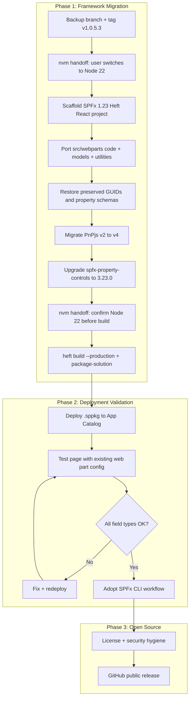

# SPFx Upgrade, Deployment Validation, and Open-Source Plan

## Current state


| Area              | Today                                                                                                                                                                                                 |
| ----------------- | ----------------------------------------------------------------------------------------------------------------------------------------------------------------------------------------------------- |
| SPFx              | **1.11.0** — Gulp 3, Node 10, TypeScript 3.3, React 16.8                                                                                                                                              |
| PnPjs             | **@pnp/sp ^2.3.0** — global `sp.setup({ spfxContext })`, `.get()` syntax                                                                                                                              |
| Legacy deps       | **@pnp/sp-taxonomy 1.3.11** (transitive, used for single-select taxonomy labels)                                                                                                                      |
| Property controls | **@pnp/spfx-property-controls ^3.0.0** (bundles PnPjs 1.3.x — version conflict)                                                                                                                       |
| Page metadata     | Read-only via `context.pageContext.listItem.id` → Site Pages list item REST query                                                                                                                     |
| Deployed version  | **1.0.5.3** in `[config/package-solution.json](config/package-solution.json)`                                                                                                                         |
| Web parts         | 2 — `[AdvancedPagePropertiesWebPart](src/webparts/advancedPageProperties/AdvancedPagePropertiesWebPart.ts)`, `[UrlPagePropertiesWebPart](src/webparts/urlPageProperties/UrlPagePropertiesWebPart.ts)` |


## Target state


| Area              | Target                                                                                                                              |
| ----------------- | ----------------------------------------------------------------------------------------------------------------------------------- |
| SPFx              | **1.23.x** (latest GA as of Jul 2026)                                                                                               |
| Toolchain         | **Heft** (`heft build`, `heft start`, `heft package-solution --production`)                                                         |
| Node              | **22.x** (per [SPFx 1.22+ requirements](https://learn.microsoft.com/en-us/sharepoint/dev/spfx/set-up-your-development-environment)) |
| PnPjs             | **v4** — `spfi().using(SPFx(context))`, invoke `()` instead of `.get()`                                                             |
| Property controls | **@pnp/spfx-property-controls 3.23.0** (SPFx 1.22.2+, no bundled PnPjs)                                                             |
| CLI               | **SPFx CLI** (preview in 1.23; GA planned 1.25 Sep 2026) for ongoing project maintenance                                            |


---

## Recommended upgrade strategy: scaffold-and-port (lowest risk)

For a **1.11 → 1.23** jump, stepping through ~12 SPFx versions incrementally creates compounding breakage (React 16→17, tslint→eslint, Fabric→Fluent, rush-stack-compiler changes, then Gulp→Heft). The source footprint is small (2 web parts, ~8 PnP call sites), so **scaffold a fresh Heft project and port code** is lower risk than 12 sequential upgrades.

Use **CLI for Microsoft 365** only as a reference generator, not as the execution path:

```powershell
m365 spfx project upgrade --outputType md
```

This produces a diff checklist of everything that changed between 1.11 and 1.23 — useful during porting, not as 12 manual upgrade commits.




---

## Node version management (nvm handoff)

This machine has **nvm** installed, but installs and version switches require **admin mode** — the agent cannot run `nvm` commands directly. Work is split into **handoff checkpoints** where the agent pauses, gives you exact commands, and waits for confirmation before continuing.

### Handoff pattern

1. Agent identifies the next step needs a specific Node version (or a version change).
2. Agent provides exact commands for an **elevated PowerShell** window.
3. You run them, then reply (e.g. "done" or paste `node -v` output).
4. Agent verifies with `node -v` / `npm -v` in the project shell and continues.

### Expected nvm checkpoints


| When                                           | Your commands (admin PowerShell)                 | Agent continues with                                            |
| ---------------------------------------------- | ------------------------------------------------ | --------------------------------------------------------------- |
| Before first `npm install` on migrated project | `nvm install 22` (if missing), then `nvm use 22` | `npm install`, toolchain merge                                  |
| Before production build / deploy validation    | `nvm use 22` (if shell was reset)                | `heft build --production`, `heft package-solution --production` |
| Optional: global SPFx CLI / Yeoman             | `nvm use 22`, then global npm installs           | `spfx --help` / scaffold validation                             |


### Repo convention

- Add `[.nvmrc](.nvmrc)` with `22` so the target version is documented (nvm on Windows may not auto-read it; it still guides handoffs).
- Agent will **not** attempt `nvm use` itself — it will ask you to switch when `node -v` is wrong.

### If Node version is wrong mid-session

If `npm install` or `heft build` fails with engine/Node errors, the agent stops and requests a handoff rather than retrying blindly.

---

## Phase 1 — SPFx and Heft migration

### 1.1 Branch and baseline

**All migration work happens on a dedicated feature branch** — `main` (or your current default branch) stays untouched until build, deploy, and in-place page validation succeed on the feature branch.

- Create branch **`feature/spfx-1.23-migration`** from current main (do not commit migration work directly to main)
- Tag current main (or the branch tip before the feature branch) as **`v1.0.5.3-pre-migration`** for rollback reference
- Merge to main only after Phase 2 deployment validation passes (PR optional but recommended)
- Document current web part GUIDs (must not change):
  - Solution: `daae06a2-8599-445c-93c0-3bd739305f56`
  - Advanced Page Properties: `bdbcb04e-9c90-4adb-b0f0-d025e4eb6cb5`
  - URL Page Properties: `a7f3c8d2-4e5b-4a9f-8c1d-3e6b9a2f4d7c`

**Why preserve GUIDs:** SharePoint binds existing page instances to web part IDs. Changing them would require re-adding web parts and reconfiguring property pane settings on every page.

### 1.2 Scaffold fresh Heft project

In a temp directory (not overwriting the repo yet):

```powershell
npm install -g @microsoft/generator-sharepoint@latest
yo @microsoft/sharepoint
# WebPart, React, solution name: advanced-page-properties, SPO latest
```

Or, once comfortable with preview tooling:

```powershell
npm install -g @microsoft/spfx-cli   # preview in 1.23
spfx init advanced-page-properties
```

Copy the **toolchain skeleton** into the repo:


| From scaffold                                                   | Into repo                                                                                        |
| --------------------------------------------------------------- | ------------------------------------------------------------------------------------------------ |
| `config/rig.json`, `config/sass.json`, `config/typescript.json` | Replace/add in `[config/](config/)`                                                              |
| `package.json` scripts (`heft build`, `heft start`, etc.)       | Replace `[package.json](package.json)` scripts                                                   |
| `tsconfig.json`, ESLint config                                  | Replace legacy tslint setup                                                                      |
| `.nvmrc` with `22`                                              | Add at repo root                                                                                 |
| Delete                                                          | `[gulpfile.js](gulpfile.js)`, `[tslint.json](tslint.json)`, `@microsoft/rush-stack-compiler-3.3` |


Reference: [Migrate Gulp to Heft](https://learn.microsoft.com/en-us/sharepoint/dev/spfx/toolchain/migrate-gulptoolchain-hefttoolchain)

### 1.3 Port application code

Copy unchanged logic from current `[src/webparts/](src/webparts/)` into the new structure, then fix compile errors:

- **React 17**: update `ReactDom.render` → `ReactDom.render` still works in 17, but follow scaffold's entry pattern
- **ThemeProvider**: already uses `@microsoft/sp-component-base` — verify import paths unchanged
- **Legacy property migration**: keep existing `selectedProperties` → `propertyConfigurations` logic in `[AdvancedPagePropertiesWebPart.ts](src/webparts/advancedPageProperties/AdvancedPagePropertiesWebPart.ts)` — this is what makes old page configs work after deploy
- **Lodash**: replace `@microsoft/sp-lodash-subset` usage or keep explicit `lodash` import (already in use)
- **Remove** duplicate `office-ui-fabric-react` 6.x — consolidate on `@fluentui/react` 8.x per modern scaffold

### 1.4 Page context — what changed and what to improve

**Good news:** `this.context.pageContext.listItem.id` remains the supported SPFx API for identifying the current Site Pages list item. This is not deprecated in 1.23. The hosted workbench and local workbench may still return `listItem: null` — existing guard clauses are correct.

**Improve during migration** (robustness, not breaking change):


| Current (fragile)                                   | Improved                                                                                                                           |
| --------------------------------------------------- | ---------------------------------------------------------------------------------------------------------------------------------- |
| Hard-coded `"Site Pages"` list title (5 call sites) | Resolve via `context.pageContext.list.id` or `context.pageContext.list.serverRelativeUrl` — works on renamed/non-English libraries |
| `sp.setup()` in React render                        | Initialize once in web part `onInit`, pass SPFI via props                                                                          |


Affected files:

- `[AdvancedPageProperties.tsx](src/webparts/advancedPageProperties/components/AdvancedPageProperties.tsx)` (L89–90, L101)
- `[UrlPageProperties.tsx](src/webparts/urlPageProperties/components/UrlPageProperties.tsx)` (L86–87)
- Both `*WebPart.ts` property-pane field discovery methods

---

## Phase 1 — PnPjs v4 migration

### 2.1 Centralize SPFI setup

Add `[src/common/pnpjsConfig.ts](src/common/pnpjsConfig.ts)` per [Microsoft/PnP guidance](https://learn.microsoft.com/en-us/sharepoint/dev/spfx/web-parts/guidance/use-sp-pnp-js-with-spfx-web-parts):

```typescript
import { spfi, SPFx, SPFI } from "@pnp/sp";
import "@pnp/sp/webs";
import "@pnp/sp/lists";
import "@pnp/sp/items";
import "@pnp/sp/fields";

let _sp: SPFI | undefined;

export function getSP(context?: WebPartContext): SPFI {
  if (context) _sp = spfi().using(SPFx(context));
  if (!_sp) throw new Error("PnPjs not initialized");
  return _sp;
}
```

- Call `getSP(this.context)` once in each web part's `onInit`
- Pass `sp` to React components via props; **remove** `sp.setup()` from component render paths

### 2.2 Mechanical API conversions (~8 call sites)


| v2 (current)                                                                | v4                                                             |
| --------------------------------------------------------------------------- | -------------------------------------------------------------- |
| `sp.web.lists.getByTitle("Site Pages").items.getById(id).select(...).get()` | `sp.web.lists.getById(listId).items.getById(id).select(...)()` |
| `fields.getByInternalNameOrTitle(prop)()`                                   | Same invoke pattern (already partially correct)                |
| `list.fields()`                                                             | `list.fields()`                                                |
| `import { sp } from "@pnp/sp/presets/all"`                                  | Explicit `@pnp/sp/*` side-effect imports                       |


### 2.3 Replace `@pnp/sp-taxonomy` (highest-risk item)

Only used in `[AdvancedPageProperties.tsx](src/webparts/advancedPageProperties/components/AdvancedPageProperties.tsx)` (L114–139) to fix unreliable single-select taxonomy labels.

**Recommended replacement:** SharePoint REST term store via PnPjs v4:

```typescript
// Example: GET /_api/v2.1/termStore/sets/{setId}/terms/{termId}
// or legacy: /_api/SP.Taxonomy.TermStore.GetTerm(termId)
```

Alternative: `@pnp/graph` term store API if API permissions are added to `[package-solution.json](config/package-solution.json)` — heavier, only needed if REST proves insufficient.

**Regression-test priority:** `TaxonomyFieldType`, `TaxonomyFieldTypeMulti`, `Thumbnail`, `URL`, `Boolean`, `DateTime`, `MultiChoice`

### 2.4 Upgrade `@pnp/spfx-property-controls`

- Bump from `^3.0.0` → `**3.23.0**` (SPFx 1.22.2+, PnPjs removed from package — resolves dual-version conflict)
- Only active control: `PropertyFieldIconPicker` in `[UrlPagePropertiesWebPart.ts](src/webparts/urlPageProperties/UrlPagePropertiesWebPart.ts)`
- Watch for Heft CSS double-hash styling issues with property controls; if `PropertyFieldIconPicker` styling breaks, apply webpack patch per [sp-dev-fx-controls-react#2082](https://github.com/pnp/sp-dev-fx-controls-react/issues/2082) or eject webpack via `heft eject-webpack`

---

## Phase 2 — Build, deploy, and validate on existing page

### 3.1 Dev environment

**Handoff (you, admin PowerShell):**

```powershell
nvm install 22    # skip if already installed
nvm use 22
node -v           # should show v22.x
```

Reply when done; agent then runs in the project directory:

```powershell
npm install
heft start          # point serve.json at tenant workbench
```

Update `[config/serve.json](config/serve.json)` to hosted workbench URL (required for `pageContext.listItem` during dev).

### 3.2 Production build

**Handoff:** confirm `nvm use 22` if the terminal session was restarted since dev setup.

Agent runs:

```powershell
heft build --production
heft package-solution --production
# Output: sharepoint/solution/advanced-page-properties.sppkg
```

Bump `[config/package-solution.json](config/package-solution.json)` version to **1.1.0.0** (or **2.0.0.0** if you want to signal the framework migration).

### 3.3 In-place deployment test matrix

Deploy to App Catalog (upgrade existing package — same solution GUID). Test on a **page that already has the old 1.0.5.3 web parts configured**:


| Test                                       | Expected                                                     |
| ------------------------------------------ | ------------------------------------------------------------ |
| Web part renders without re-adding to page | Existing instance loads new bundle                           |
| Property pane configs preserved            | `propertyConfigurations` / `urlProperties` intact            |
| Legacy `selectedProperties` migration      | Capsule fields still display (runtime migration in web part) |
| All configured field types render          | Especially taxonomy, thumbnail, URL, boolean                 |
| Capsule search links                       | `capsuleLinkUrl`, query-string field behavior                |
| URL web part iframe mode                   | `embedHeight`, `hideEmbedChrome`                             |
| Theme variants                             | Light/dark section themes                                    |
| Edit mode vs read mode                     | Property pane opens, values refresh                          |


### 3.4 Adopt SPFx CLI workflow

After successful build/deploy:

```powershell
npm install -g @microsoft/spfx-cli   # preview now; GA Sep 2026
spfx --help                          # validate project-compatible commands
```

Expected day-to-day commands post-migration:

- `heft start` — local dev
- `heft build --production && heft package-solution --production` — release build
- SPFx CLI — scaffolding new components, upgrades, template management (replacing Yeoman over time)

Keep Yeoman as fallback until SPFx CLI reaches GA (1.25).

---

## Phase 3 — Open-source on GitHub (MIT, ThreeWill)

**Prerequisite:** Phase 2 deployment validation complete.

### 4.1 License and metadata


| Item                                                           | Action                                                                                                                  |
| -------------------------------------------------------------- | ----------------------------------------------------------------------------------------------------------------------- |
| `LICENSE`                                                      | Add MIT text, copyright **ThreeWill**                                                                                   |
| `[package.json](package.json)`                                 | Add `"license": "MIT"`, `"repository"`, `"author": "ThreeWill"`                                                         |
| `[README.md](README.md)`                                       | Add license badge; keep ThreeWill attribution per your choice                                                           |
| `[config/package-solution.json](config/package-solution.json)` | Update `developer` block for public maintainer info; review MPN ID `990019737` — keep if still valid publisher identity |


### 4.2 Security hygiene (no secrets found in current tree)


| Item                       | Action                                                                                                                                                                                                                                                                    |
| -------------------------- | ------------------------------------------------------------------------------------------------------------------------------------------------------------------------------------------------------------------------------------------------------------------------- |
| `[.gitignore](.gitignore)` | Add `.env`, `.env.*`, `*.pem`, `*.pfx`, `credentials.json`                                                                                                                                                                                                                |
| Debug logging              | Remove `console.log(allValues)` in `[UrlPageProperties.tsx](src/webparts/urlPageProperties/components/UrlPageProperties.tsx)` L88; gate or remove debug logs in `[AdvancedPageProperties.tsx](src/webparts/advancedPageProperties/components/AdvancedPageProperties.tsx)` |
| Git history                | Run secret scanner on full history before first public push (e.g. `gitleaks`, GitHub secret scanning)                                                                                                                                                                     |
| CDN config                 | Confirm `[config/deploy-azure-storage.json](config/deploy-azure-storage.json)` placeholders stay as placeholders                                                                                                                                                          |


### 4.3 Repo polish

- Fix README broken image references (`diff-screencap.png`, `add-to-page.png`, `props.gif`) — add assets or remove links
- Add `SECURITY.md` with vulnerability reporting contact
- Optional: `CONTRIBUTING.md`, GitHub issue templates
- Remove `"private": true` from `package.json` if publishing to npm; optional for GitHub-only
- Enable GitHub Dependabot, branch protection, and Actions CI (`heft build --production` on PR)

### 4.4 What stays public-safe

- Solution and web part GUIDs — public by design, required for deployment continuity
- No tenant URLs, client IDs, or credentials in codebase today

---

## Risk register


| Risk                                                        | Mitigation                                                               |
| ----------------------------------------------------------- | ------------------------------------------------------------------------ |
| Taxonomy label regression after removing `@pnp/sp-taxonomy` | Test first on page with taxonomy fields; keep REST fallback to raw label |
| Property control CSS breakage under Heft                    | Upgrade to 3.23.0; webpack patch if needed                               |
| `listItem` null on non-page hosts                           | Existing empty-state handling; document "Site Pages only" in README      |
| Old bundle coexistence                                      | Do not delete previous CDN bundles until all pages confirmed upgraded    |
| SPFx CLI still preview                                      | Use Heft npm scripts as primary; adopt CLI incrementally                 |
| Wrong Node version in agent shell                           | Pause for nvm handoff; verify `node -v` before npm/heft                  |


---

## Suggested version bump

- Framework migration: **1.1.0.0** (same solution GUID, new framework)
- Document breaking changes in README changelog (Node 22, Heft commands, dev setup)

---

## Execution order summary

1. **Create `feature/spfx-1.23-migration`** from main + tag pre-migration baseline (all work on feature branch)
2. **nvm handoff** — you install/switch to Node 22 (admin)
3. Scaffold SPFx 1.23 Heft project → merge toolchain into repo → `npm install`
4. Port web part source, preserve GUIDs and property schemas
5. PnPjs v4 + `pnpjsConfig.ts` + list ID resolution
6. Replace taxonomy API + upgrade property controls
7. **nvm handoff** (if needed) → `heft build --production` → deploy → validate on existing configured page
8. Install/adopt SPFx CLI (optional nvm handoff for global tools)
9. LICENSE, security hygiene, GitHub publish

